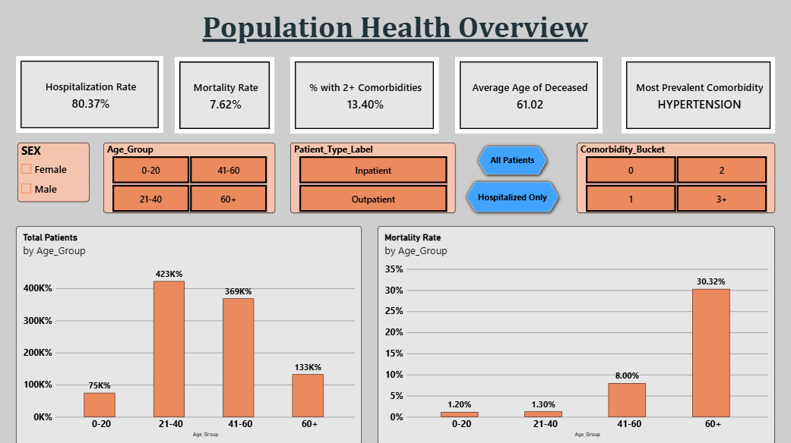
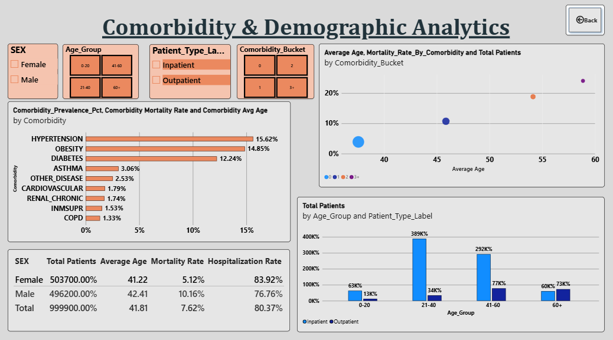

<div align="center">

# COVID-19 Patient Outcomes Analytics

**A Power BI project for exploring COVID-19 patient outcomes, demographics, care pathways, and comorbidity patterns.**

[](powerbi/Covid_Pateint_Dashboard.pbix)
[](data/COVID19_Data.csv)
[](#dataset-at-a-glance)
[](#project-contents)

</div>

---

## Project overview

This repository contains a patient-level COVID-19 dataset and a Power BI report designed to summarize outcomes and compare patient groups. The report combines demographic and clinical indicators with hospitalization, intensive-care, intubation, and death outcomes. Its measures and visuals are intended for descriptive exploration: they help users see how the supplied records are distributed, not establish that any characteristic caused an outcome.

The report's model includes the `Covid_Patients` table, a `Comorbidity_Long` table, and a measures table. It also uses derived groupings such as `Age_Group`, `Patient_Type_Label`, and `Comorbidity_Bucket`. The PBIX is the interactive analytical deliverable; the CSV is the accompanying source file supplied with the project.

## About

COVID-19 Patient Outcomes Analytics is a Power BI portfolio project for exploring how recorded demographics, care pathways, and comorbidities relate to patient outcome patterns in the supplied extract. The report is organized into population overview, comorbidity and demographic analysis, and outcome-distribution views, with slicers and age-group drillthrough for cohort exploration. It is a descriptive analytics artifact, not a clinical decision tool; the dataset's source and codebook were not supplied, so interpretations should remain cautious.

## Dashboard screenshots

The first two page screenshots have been added. The screenshot for **Outcome Trends & Distribution** is still pending and will be added when supplied.

### Population Health Overview



### Comorbidity & Demographic Analytics



### Outcome Trends & Distribution


## Project contents

```text
.
├── data/
│   └── COVID19_Data.csv
├── images/
│   ├── population-health-overview.png
│   └── comorbidity-demographic-analytics.png
├── powerbi/
│   └── Covid_Pateint_Dashboard.pbix
└── README.md
```

The dashboard filename preserves the spelling of the uploaded file. The `.pbix` is a binary Power BI Desktop report and may contain an embedded copy of the model data.

## Dataset at a glance

The supplied CSV has **9,999 records and 22 columns**. The observed age range is 0–115 years, with a median age of 41. The file has no blank/null cells, but this does **not** mean every value is a valid observed measurement: multiple clinical fields contain numeric sentinel codes such as `97`, `98`, or `99`.

The file itself does not include a codebook, source URL, collection dates, or a description of the sampling method. Those details should be added by the data owner before making claims about geographic coverage, representativeness, or how sentinel values should be recoded. The descriptions below are based on column names and observed values, not a verified source codebook.

| Field | What it represents in this file |
|---|---|
| `ID` | Row/patient record identifier; not a descriptive clinical feature. |
| `USMER` | Numeric care/service classification code. Exact categories are not defined in the supplied file. |
| `MEDICAL_UNIT` | Numeric medical-unit code. Exact facility/unit labels are not included. |
| `SEX` | Recorded sex category (`Female`, `Male`). |
| `PATIENT_TYPE` | Numeric patient-type/care setting code. Confirm the code mapping before assigning labels. |
| `INTUBED` | Intubation indicator/code. Includes `0`, `1`, and special codes. |
| `PNEUMONIA` | Pneumonia indicator/code. Includes `0`, `1`, and special codes. |
| `AGE` | Age in years as stored in the supplied extract. |
| `PREGNANT` | Pregnancy indicator/code. Includes special codes and may not be applicable to all records. |
| `DIABETES` | Diabetes indicator/code. |
| `COPD` | COPD indicator/code. |
| `ASTHMA` | Asthma indicator/code. |
| `INMSUPR` | Immunosuppression indicator/code. |
| `HYPERTENSION` | Hypertension indicator/code. |
| `OTHER_DISEASE` | Other-disease indicator/code. |
| `CARDIOVASCULAR` | Cardiovascular-condition indicator/code. |
| `OBESITY` | Obesity indicator/code. |
| `RENAL_CHRONIC` | Chronic-renal-condition indicator/code. |
| `TOBACCO` | Tobacco-use indicator/code. |
| `ICU` | Intensive-care indicator/code. Includes `0`, `1`, and special codes. |
| `DEGREE` | Numeric category code; the supplied file does not define its labels. |
| `DEATH` | Death outcome indicator as stored in the extract (`0` or `1` observed). |

### Important code-handling note

Several fields contain values beyond `0` and `1`. These special values are data codes, not blank cells. Do not count them as positive clinical conditions or ordinary numeric quantities. For analysis or model changes, consult the original dataset's codebook and explicitly map valid, unknown, and not-applicable values. In particular, `97`, `98`, and `99` occur in different fields, so one blanket recoding rule should not be assumed without confirming the source definitions.

## Power BI report guide

Open `powerbi/Covid_Pateint_Dashboard.pbix` in Microsoft Power BI Desktop. The report contains three pages:

1. **Population Health Overview** — KPI cards for hospitalization rate, mortality rate, the share of patients with two or more comorbidities, average age of deceased patients, and the most prevalent comorbidity. It also compares patient counts and mortality rate across age groups. The page includes demographic and cohort slicers.
2. **Comorbidity & Demographic Analytics** — A drillthrough page associated with age groups. It compares comorbidity prevalence, average age, and mortality-rate measures; plots comorbidity groupings against patient count, average age, and mortality; and shows demographic/care summaries by sex and patient type.
3. **Outcome Trends & Distribution** — Compares mortality rate by comorbidity bucket, presents mortality by age group and sex, and shows patient-type distribution and counts across age/comorbidity groups.

The labels above describe the visuals and fields found in the uploaded PBIX. The exact formulas behind each displayed measure should be reviewed in the model before using KPI values in external reporting. Slicers and cross-filtering change the denominator and interpretation of many visuals.

### Metric validation note

The supplied CSV contains 9,999 rows, while the first two screenshots show some patient-count visuals in the hundreds of thousands and a demographic table total near 100,000. Those displayed totals do not reconcile directly to the supplied CSV as it currently stands. The PBIX may use a larger source, a transformed or expanded model, or measures with different counting/formatting logic. Verify the model's source row count, joins, filters, and DAX definitions before presenting the screenshots' KPI values as results from this CSV.

## How to use

1. Clone or download this repository.
2. Open the `.pbix` file in Power BI Desktop.
3. Use the report pages, slicers, cross-highlighting, and age-group drillthrough to explore the report's existing model.
4. Before replacing the model data or refreshing from the CSV, verify the model's source path, transformations, data types, and special-code handling. The model may include an embedded snapshot, so the file can open independently of the CSV while still reflecting an earlier import.
5. To reproduce or extend an analysis, document any recoding, filters, exclusions, and measure definitions. Validate results against the source codebook.

## Interpretation and responsible use

This is a descriptive dashboard over the records supplied with the project. It should not be used to diagnose, treat, or make individual care decisions. Relationships shown in filtered or aggregated groups are observational and do not establish causality. Results may be affected by record selection, coding practices, missingness represented by sentinel values, and unknown dataset provenance.

The CSV contains health-related attributes and outcomes alongside record IDs. Although names and direct contact details are not present in the supplied columns, health data can remain sensitive, and combinations of attributes can carry re-identification risk. Review the source, permissions, de-identification, and applicable privacy rules before distributing the data or the PBIX. **The target GitHub repository is public**, and the PBIX may embed the data.

## Reproducibility and licensing

No source code, transformation script, source citation, or codebook was included with the supplied files. This repository therefore documents the delivered artifacts rather than asserting a reproducible ETL pipeline. Add the original dataset citation, its terms of use, the codebook, and documented DAX/model definitions when available.

No `LICENSE` file is included. Unless the owner adds an explicit license and confirms the dataset/report redistribution rights, do not assume that public access grants permission to reuse or redistribute these materials.

## Repository files

- [`data/COVID19_Data.csv`](data/COVID19_Data.csv) — supplied CSV extract.
- [`images/population-health-overview.png`](images/population-health-overview.png) — first dashboard page screenshot.
- [`images/comorbidity-demographic-analytics.png`](images/comorbidity-demographic-analytics.png) — second dashboard page screenshot.
- [`powerbi/Covid_Pateint_Dashboard.pbix`](powerbi/Covid_Pateint_Dashboard.pbix) — supplied Power BI report.
